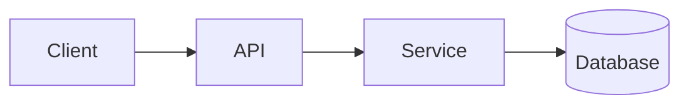

# 架構說明

<!-- Claude 需要時才會讀這份文件（CLAUDE.md 沒有用 @ 引用），可以寫得比 CLAUDE.md 詳細 -->

## 系統概觀
<系統做什麼、主要使用者、核心流程。可以放一張 Mermaid 圖>

## 模組與職責
| 模組 | 職責 | 備註 |
|---|---|---|
| <module> | <負責什麼> | <依賴、限制> |

## 資料模型
<主要實體、關聯、重要欄位與限制>

## 外部依賴
<第三方 API、佇列、快取、儲存服務，以及各自的用途>

## 部署與環境
<環境清單（dev / staging / prod）、部署方式、重要環境變數名稱（不要寫值）>

## 已知限制與技術債
- <項目>
